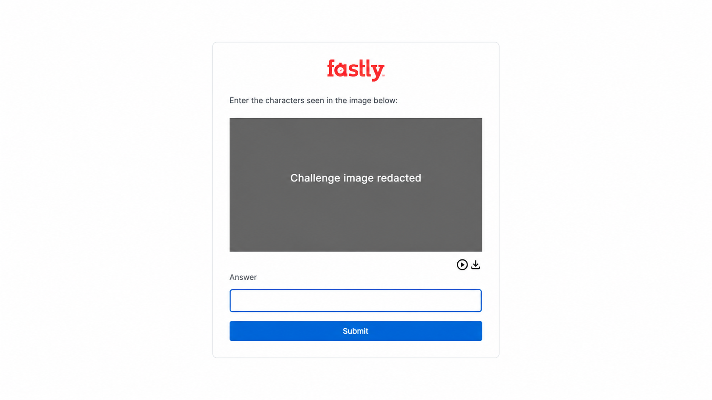

# PyPI browser-challenge probe

This record supports [issue #36](https://github.com/browser-to-mcp/browser-to-mcp/issues/36). It documents why a browser-based PyPI package-search workflow was not added.



The challenge graphic in the screenshot has been deliberately redacted. This project does not attempt to solve, bypass, or automate browser challenges.

## Probe details

- Target URL: `https://pypi.org/search/?q=fastapi`
- Browser: Chromium `149.0.7827.55`
- Playwright: `1.61.0`
- Workflow actions:
  1. `goto` completed in about 0.73 seconds.
  2. `extract_text` for the page `main` element timed out after 30 seconds.

The rendered page requested that a user complete a browser challenge. The workflow therefore cannot reliably obtain package-search results through this browser route.

## Recorded failure

```json
{
  "category": "runtime",
  "path": "steps.results",
  "message": "Action 'extract_text' timed out after 30 seconds."
}
```

## Follow-up

Issue #36 tracks the compliant decision: identify a supported browser path, define a separately scoped API-backed tool, or explicitly mark PyPI browser search unsupported. No challenge-evasion work is in scope.
